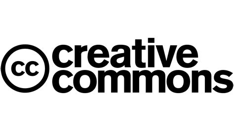

# Repositórios digitais

## Encontrar e reutilizar conteúdos com responsabilidade

---
layout: default
---

# Para relembrar....

---
layout: default
---

# O que é um repositório digital?

  
É um serviço que reúne e organiza conteúdos digitais para que possamos encontrá-los e consultá-los.

  

    
Imagens

    
Livros

    
Documentos

    
Arte e cultura

  

---
layout: default
---

# Exemplos de repositórios

  

    
    
Wikimedia Commons Imagens, áudio e vídeo

  

  

    
    
Europeana Arte, cultura e história

  

  

    <h2 class="text-2xl mb-3">Biblioteca Nacional Digital</h2>
    
Livros, jornais e documentos digitalizados.

  

  

    <h2 class="text-2xl mb-3">Pexels e Unsplash</h2>
    
Fotografias; consulta sempre as condições de utilização.

  

---
layout: default
---

# Encontrar um conteúdo

  

    
1

    
Pesquisa por tema.

  

  

    
2

    
Usa filtros para restringir os resultados.

  

  

    
3

    
Abre a página do conteúdo.

  

  

    
4

    
Verifica autor, data e licença.

  

A licença pode ser diferente para cada imagem ou documento, mesmo dentro do mesmo repositório.

---
layout: default
---

# O que é uma licença?

  

    
A licença explica o que podemos fazer com uma obra criada por outra pessoa.

  

  

    <h2 class="text-2xl mb-4">Antes de reutilizar</h2>
    <ul class="space-y-4 text-xl">
      <li>Confirma se a reutilização é permitida.</li>
      <li>Verifica se é necessário indicar o autor.</li>
      <li>Respeita outras condições, como não alterar a obra.</li>
    </ul>
  

---
layout: default
---

# Creative Commons

  

    
As licenças Creative Commons permitem que os autores indiquem condições de reutilização das suas obras.

    
Não significam que todas as obras possam ser usadas sem condições.

  

  

    
  

---
layout: center
---

# Desafio rápido

  Encontra uma fotografia num repositório. Onde encontraste a licença? Que condições tens de cumprir para a usar num trabalho?

